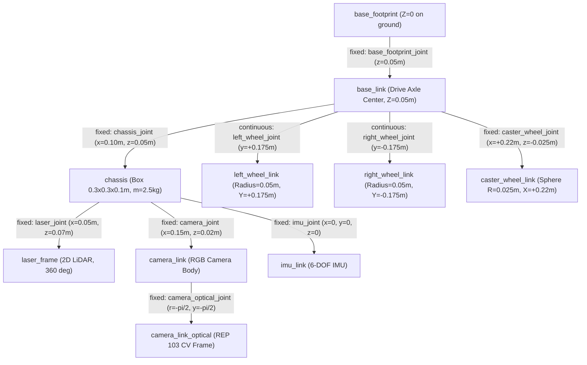
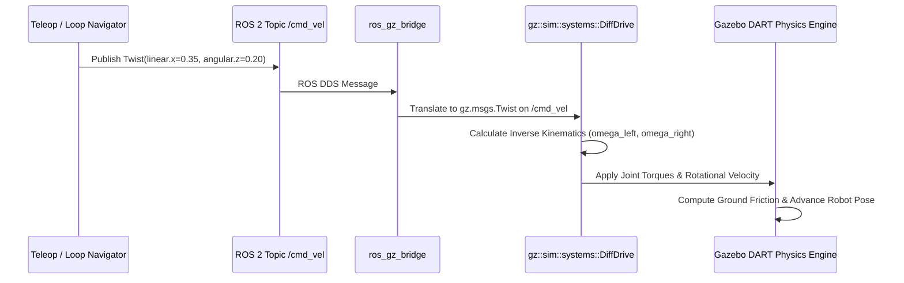
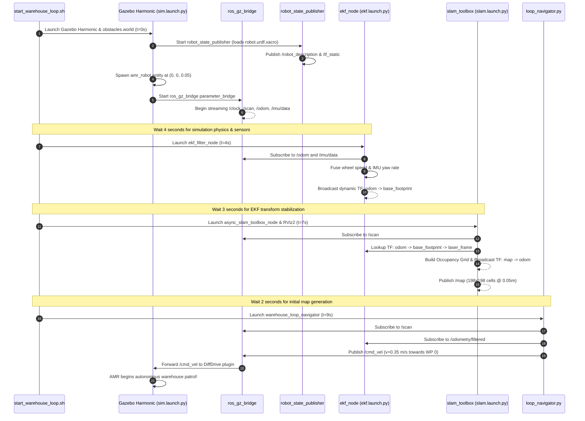
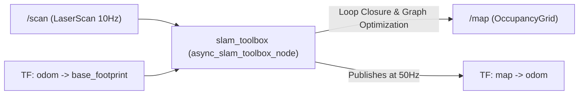
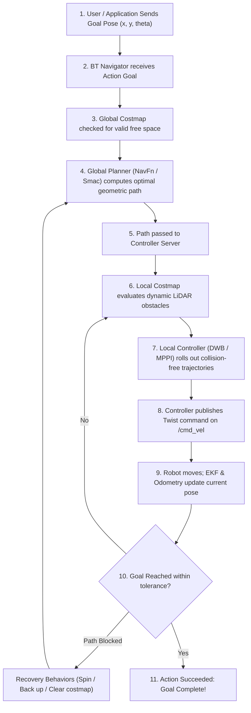
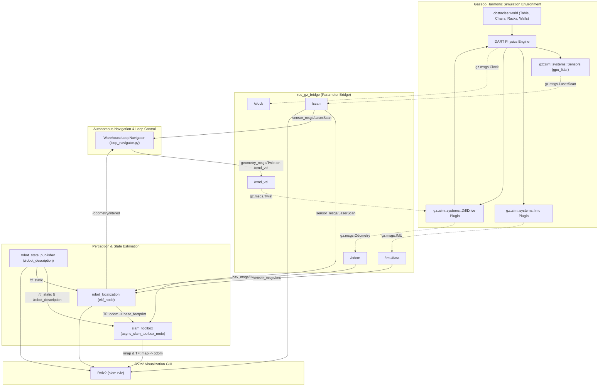

# Complete Beginner-to-Advanced Autonomous Mobile Robot (AMR) Simulation Guide
**A Comprehensive Engineering Handbook for Physics, Kinematics, SLAM, Sensor Fusion, and Autonomous Navigation in ROS 2 & Gazebo Harmonic**

---

## Document Overview & Learning Objectives

This technical guide explains the complete internal architecture of the Autonomous Mobile Robot (AMR) system implemented in this repository. It is designed to take a reader from foundational concepts in mechanics, coordinate frames, and mathematics to advanced topics in state estimation, Simultaneous Localization and Mapping (SLAM), and collision-free autonomous navigation.

Every concept is grounded directly in the source files, configurations, and simulation assets of this repository:
- Workspace Path: `/home/karthik/Documents/Projects/autonomous-mobile-robot`
- ROS 2 Distribution: **ROS 2 Jazzy Jalisco** (Ubuntu 24.04 LTS Noble Numbat)
- Simulation Engine: **Gazebo Harmonic (gz-sim 8)** via `ros_gz`

---

# Table of Contents

- [PART 1 — Understand the AMR From Zero](#part-1--understand-the-amr-from-zero)
  - [1. What Is an Autonomous Mobile Robot?](#1-what-is-an-autonomous-mobile-robot)
  - [2. Essential Robotics Mathematics](#2-essential-robotics-mathematics)
- [PART 2 — Robot Modeling and Physics](#part-2--robot-modeling-and-physics)
  - [3. How the Robot Model Works (URDF & Xacro)](#3-how-the-robot-model-works-urdf--xacro)
  - [4. How Gazebo Simulates Robot Physics](#4-how-gazebo-simulates-robot-physics)
- [PART 3 — Motor Motion and Differential-Drive Kinematics](#part-3--motor-motion-and-differential-drive-kinematics)
  - [5. How Motors Move the Robot](#5-how-motors-move-the-robot)
  - [6. Differential-Drive Kinematics](#6-differential-drive-kinematics)
  - [7. How /cmd_vel Controls the Robot](#7-how-cmd_vel-controls-the-robot)
  - [8. Wheel Odometry](#8-wheel-odometry)
- [PART 4 — ROS 2 Architecture and Execution Flow](#part-4--ros-2-architecture-and-execution-flow)
  - [9. How ROS 2 Components Communicate](#9-how-ros-2-components-communicate)
  - [10. Complete Launch and Startup Sequence](#10-complete-launch-and-startup-sequence)
- [PART 5 — TF2 and Coordinate Frames](#part-5--tf2-and-coordinate-frames)
  - [11. Coordinate Frames From Scratch](#11-coordinate-frames-from-scratch)
- [PART 6 — Sensor Simulation and Perception](#part-6--sensor-simulation-and-perception)
  - [12. LiDAR (Light Detection and Ranging)](#12-lidar-light-detection-and-ranging)
  - [13. RGB Camera](#13-rgb-camera)
  - [14. Inertial Measurement Unit (IMU)](#14-inertial-measurement-unit-imu)
- [PART 7 — Localization and Sensor Fusion](#part-7--localization-and-sensor-fusion)
  - [15. Localization Versus Odometry Versus SLAM](#15-localization-versus-odometry-versus-slam)
  - [16. Extended Kalman Filter (EKF) with robot_localization](#16-extended-kalman-filter-ekf-with-robot_localization)
- [PART 8 — SLAM: How the Robot Builds a Map](#part-8--slam-how-the-robot-builds-a-map)
  - [17. SLAM From Zero](#17-slam-from-zero)
  - [18. Occupancy Grid Maps](#18-occupancy-grid-maps)
  - [19. SLAM Toolbox Implementation](#19-slam-toolbox-implementation)
- [PART 9 — Autonomous Navigation With Nav2](#part-9--autonomous-navigation-with-nav2)
  - [20. What Happens When I Send a Navigation Goal?](#20-what-happens-when-i-send-a-navigation-goal)
  - [21. Global Planning](#21-global-planning)
  - [22. Costmaps (Global & Local)](#22-costmaps-global--local)
  - [23. Local Control and Obstacle Avoidance](#23-local-control-and-obstacle-avoidance)
  - [24. Behavior Trees and Recovery Actions](#24-behavior-trees-and-recovery-actions)
  - [25. Systematic Navigation Debugging](#25-systematic-navigation-debugging)
- [PART 10 — Complete System Data Flow](#part-10--complete-system-data-flow)
  - [26. End-to-End AMR Architecture](#26-end-to-end-amr-architecture)
  - [27. One Complete Navigation Cycle](#27-one-complete-navigation-cycle)
- [PART 11 — Repository Folder and File Guide](#part-11--repository-folder-and-file-guide)
  - [28. Repository Inventory and Relationship Matrix](#28-repository-inventory-and-relationship-matrix)
  - [29. Parameter Deep-Dive: Why Every Configuration Setting Exists](#29-parameter-deep-dive-why-every-configuration-setting-exists)
- [PART 12 — Practical Commands and Verification](#part-12--practical-commands-and-verification)
  - [30. Essential ROS 2 Command Reference](#30-essential-ros-2-command-reference)
- [PART 13 — Learning Exercises](#part-13--learning-exercises)
  - [31. Hands-on Experiments (Beginner to Advanced)](#31-hands-on-experiments-beginner-to-advanced)
- [PART 14 — Final Reference](#part-14--final-reference)
  - [32. Important Concepts Cheat Sheet](#32-important-concepts-cheat-sheet)
  - [33. The Master Mental Model](#33-the-master-mental-model)

---

# PART 1 — Understand the AMR From Zero

## 1. What Is an Autonomous Mobile Robot?

### 1.1 Definition: AMR vs. AGV
An **Autonomous Mobile Robot (AMR)** is a computer-controlled mobile vehicle capable of understanding its environment and navigating dynamically without fixed external infrastructure.

In industrial automation, vehicles are divided into two distinct categories:
- **Automated Guided Vehicles (AGVs)**: Follow fixed paths embedded in the facility (such as magnetic tape on the floor, optical wire tracks, or QR code grids). If a person or box blocks an AGV's path, the AGV halts until the obstacle is manually cleared. It cannot navigate around the obstacle.
- **Autonomous Mobile Robots (AMRs)**: Build internal maps of the environment using LiDAR, vision, and odometry. An AMR dynamically computes paths from point A to point B. If an unexpected obstacle (such as a chair, forklift, or worker) enters its path, the AMR's local planner computes an alternate path in real time to steer around it.

| Feature | Automated Guided Vehicle (AGV) | Autonomous Mobile Robot (AMR) |
| :--- | :--- | :--- |
| **Pathing** | Fixed magnetic tape, wires, or markers | Dynamic path planning via SLAM & costmaps |
| **Obstacle Handling** | Stops and waits | Dynamically navigates around obstacles |
| **Facility Modification**| Requires physical track installation | Zero physical changes; maps via software |
| **Adaptability** | Low; changing route requires re-taping | High; routes modified by sending coordinates |

### 1.2 Anatomy of an AMR
A physical AMR consists of 6 core subsystems:
1. **Chassis & Body**: The structural skeleton supporting all components. It defines the payload area, center of gravity, and geometric boundaries (footprint).
2. **Drive Wheels**: Actuated motorized wheels that translate motor torque into ground friction to move the robot.
3. **Passive Support (Caster)**: A free-rolling sphere or swivel wheel that keeps a two-wheel differential robot balanced without adding kinematic drive constraints.
4. **Proprioceptive Sensors**: Sensors measuring the robot's *internal* physical state (wheel encoders measuring rotation, 6-axis IMU measuring angular velocity and linear acceleration).
5. **Exteroceptive Sensors**: Sensors measuring the *external* environment (2D LiDAR measuring obstacle distances, RGB camera capturing color imagery).
6. **Onboard Computing Brain**: An industrial PC or single-board computer (such as an NVIDIA Jetson, Intel NUC, or Raspberry Pi) running the real-time operating system, middleware (ROS 2), and navigation software stack.

```
+--------------------------------------------------------------------------+
|                       ONBOARD COMPUTING SYSTEM (ROS 2)                   |
|                                                                          |
|   +-------------------+    +--------------------+    +---------------+   |
|   |    PERCEPTION     |    |   LOCALIZATION     |    |   PLANNING    |   |
|   |  (LiDAR, Camera)  |--->|    (EKF, SLAM)     |--->|  (Costmaps,   |   |
|   |                   |    |                    |    |   Nav2, Path) |   |
|   +-------------------+    +--------------------+    +-------+-------+   |
|                                                              |           |
|                                                              v           |
|                                                      +---------------+   |
|                                                      |    CONTROL    |   |
|                                                      |   (/cmd_vel)  |   |
|                                                      +-------+-------+   |
+--------------------------------------------------------------|-----------+
                                                               v
                                                      +-----------------+
                                                      |   ACTUATION     |
                                                      | (Motors/Wheels) |
                                                      +-----------------+
```

### 1.3 Simulated AMR vs. Physical AMR
In a physical robot, motors consume electrical current from a lithium battery, encoders emit quadrature digital pulses to a micro-controller, and LiDAR lasers emit photons that reflect off drywall.

In a simulation (Gazebo Harmonic):
- **Physics Engine (DART/Bullet)**: Replaces physical reality by numerically integrating Newton's and Euler's equations of motion at discrete time steps (e.g., $\Delta t = 1\text{ ms}$).
- **Joint Actuator Plugin**: Instead of PWM motor signals, the `gz::sim::systems::DiffDrive` plugin directly commands rotational velocities $\omega$ to wheel joints in the physics engine.
- **Ray-Tracing Sensor Simulation**: Instead of physical photons, Gazebo casts mathematical rays from the robot's sensor origin into the 3D polygon meshes of the simulated world to calculate range values.

### 1.4 Autonomy in Practice: The Sense-Plan-Act Loop
True autonomy operates in a continuous closed loop:
1. **Perceive (Sense)**: Read 360 laser distance measurements from the LiDAR and IMU acceleration.
2. **Localize**: Calculate where the robot is located in the world $(x, y, \theta)$ by fusing wheel rotation with IMU measurements and matching LiDAR scans to the known map.
3. **Plan**: Calculate a collision-free geometric line (global path) to the goal, and identify dynamic obstacles on a local costmap.
4. **Act (Control)**: Convert the path into linear velocity $v_x$ and angular velocity $\omega_z$, and command the left and right wheel motors to execute the movement.

---

## 2. Essential Robotics Mathematics

### 2.1 Coordinate Systems: The Right-Hand Rule
ROS 2 strictly follows the **REP 103 Standard** (standard coordinate orientations for mobile robots):
- **$+X$**: Points **Forward** (in the direction of robot travel).
- **$+Y$**: Points to the **Left** of the robot.
- **$+Z$**: Points **Up** (perpendicular to the floor).

```
          +Z (Up)
           ^
           |
           |   +X (Forward)
           |  /
           | /
           |/
           +--------> +Y (Left)
```

Rotations follow the right-hand rule (counter-clockwise is positive):
- **Roll ($\phi$)**: Rotation around the $X$-axis (tilting left/right).
- **Pitch ($\theta_{\text{pitch}}$)**: Rotation around the $Y$-axis (tilting forward/backward).
- **Yaw ($\theta$ or $\psi$)**: Rotation around the $Z$-axis (heading/steering direction on the ground).

For planar mobile robots moving on a flat warehouse floor:
$$\text{Roll} = 0, \quad \text{Pitch} = 0, \quad Z = 0$$
The state of the robot in the 2D plane is fully described by its **Pose**:
$$\mathbf{p} = \begin{bmatrix} x \\ y \\ \theta \end{bmatrix}$$
where:
- $x$ is the position along the $X$-axis in meters ($\text{m}$).
- $y$ is the position along the $Y$-axis in meters ($\text{m}$).
- $\theta$ is the orientation angle (yaw heading) in radians ($\text{rad}$).

### 2.2 Angles: Radians and Degrees
In ROS 2, all angles are computed in radians.
$$\text{rad} = \text{deg} \times \frac{\pi}{180^\circ}, \qquad \text{deg} = \text{rad} \times \frac{180^\circ}{\pi}$$
Key standard conversions:
- $0^\circ = 0\text{ rad}$
- $45^\circ = \frac{\pi}{4} \approx 0.7854\text{ rad}$
- $90^\circ = \frac{\pi}{2} \approx 1.5708\text{ rad}$ (Quarter turn left)
- $180^\circ = \pi \approx 3.1416\text{ rad}$ (Half turn / facing backward)
- $360^\circ = 2\pi \approx 6.2832\text{ rad}$ (Full revolution)

### 2.3 Linear Velocity, Angular Velocity, and Acceleration
- **Linear Velocity ($v$ or $\dot{x}$)**: Rate of translation across the floor. Unit: meters per second ($\text{m/s}$).
- **Angular Velocity ($\omega$ or $\dot{\theta}$)**: Rate of rotation around the vertical $Z$-axis. Unit: radians per second ($\text{rad/s}$).
- **Linear Acceleration ($a$ or $\ddot{x}$)**: Rate of change of linear speed. Unit: $\text{m/s}^2$.
- **Angular Acceleration ($\alpha$ or $\ddot{\theta}$)**: Rate of change of rotational speed. Unit: $\text{rad/s}^2$.

### 2.4 Wheel Kinematic Parameters
For our robot model defined in [robot_core.xacro](file:///home/karthik/Documents/Projects/autonomous-mobile-robot/src/amr_description/urdf/robot_core.xacro#L16-L20):
- **Wheel Radius ($r$)**: Distance from the center axle to the outer rim of the wheel.
  $$r = 0.05\text{ m} \quad (5\text{ cm})$$
- **Wheel Separation / Track Gauge ($L$)**: Distance between the contact patches of the left and right wheels.
  $$L = 2 \times \text{wheel\_offset\_y} = 2 \times 0.175\text{ m} = 0.35\text{ m} \quad (35\text{ cm})$$
- **Wheel Circumference ($C$)**:
  $$C = 2\pi r = 2\pi(0.05\text{ m}) \approx 0.3142\text{ m} \quad (31.42\text{ cm per revolution})$$

### 2.5 Converting Wheel RPM to Linear Speed
If a drive wheel rotates at $N$ revolutions per minute ($\text{RPM}$):
$$\omega_{\text{wheel}} = \frac{2\pi N}{60} \quad [\text{rad/s}]$$
$$v_{\text{wheel}} = \omega_{\text{wheel}} \times r = \frac{2\pi N r}{60} \quad [\text{m/s}]$$

**Numerical Example**:
If a wheel spins at $60\text{ RPM}$:
$$\omega_{\text{wheel}} = \frac{2\pi \times 60}{60} = 6.2832\text{ rad/s}$$
$$v_{\text{wheel}} = 6.2832\text{ rad/s} \times 0.05\text{ m} = 0.3142\text{ m/s}$$

---

# PART 2 — Robot Modeling and Physics

## 3. How the Robot Model Works (URDF & Xacro)

### 3.1 URDF Fundamentals: Links and Joints
In ROS 2, robots are modeled using **URDF (Unified Robot Description Format)**, an XML schema representing rigid multitrack kinematic mechanisms:
- **Link (`<link>`)**: A rigid body with mass, moment of inertia, visual 3D geometry, and collision boundaries. A link cannot flex or deform.
- **Joint (`<joint>`)**: A kinematic constraint connecting a **Parent Link** to a **Child Link**, defining how the child link is allowed to move relative to the parent.

```
       [Parent Link]
             |
             v <joint> (defines origin translation, rotation, and motion axis)
       [Child Link]
```

Joint Types used in mobile robots:
1. **Fixed (`fixed`)**: Rigid lock. Child cannot move relative to parent. (Used for sensor mounts, chassis structures, casters).
2. **Continuous (`continuous`)**: Continuous $360^\circ$ rotational motion with no angle limits. (Used for differential drive wheels).
3. **Revolute (`revolute`)**: Rotational joint with explicit minimum and maximum angle limits (e.g., steering arm on an Ackermann car).
4. **Prismatic (`prismatic`)**: Sliding linear motion along an axis (e.g., an elevator lift on a warehouse pallet AMR).

### 3.2 Visual Geometry vs. Collision Geometry
Inside every `<link>`, geometry is declared twice for two distinct purposes:
- **`<visual>`**: Determines how the robot looks when rendered on screen in RViz2 or the Gazebo GUI. It can use detailed 3D CAD meshes (`.stl`, `.dae`) with textures and colors.
- **`<collision>`**: Determines the physical volume used by the simulation's physics engine to calculate contact dynamics and collisions. To keep simulation speeds at real-time rates ($1000\text{ Hz}$ physics loop), collision geometry should use simplified geometric primitives (`<box>`, `<cylinder>`, `<sphere>`).

```xml
<!-- Example from robot_core.xacro -->
<visual>
  <geometry><cylinder radius="0.05" length="0.04"/></geometry>
  <material name="blue"/>
</visual>
<collision>
  <geometry><cylinder radius="0.05" length="0.04"/></geometry>
</collision>
```

### 3.3 Inertial Dynamics and Moments of Inertia
For Gazebo's physics engine to compute realistic acceleration when forces and motor torques are applied, every moving link must define:
1. **Mass ($m$)**: Weight in kilograms ($\text{kg}$).
2. **Center of Mass ($\text{origin}$)**: 3D point inside the link where its mass is concentrated.
3. **Moments of Inertia ($I_{xx}, I_{yy}, I_{zz}, I_{xy}, I_{xz}, I_{yz}$)**: The $3 \times 3$ rotational inertia tensor describing resistance to rotational acceleration around the $X$, $Y$, and $Z$ axes:
   $$\mathbf{I} = \begin{bmatrix} I_{xx} & I_{xy} & I_{xz} \\ I_{xy} & I_{yy} & I_{yz} \\ I_{xz} & I_{yz} & I_{zz} \end{bmatrix}$$

In our repository, [inertial_macros.xacro](file:///home/karthik/Documents/Projects/autonomous-mobile-robot/src/amr_description/urdf/inertial_macros.xacro) automates these exact physical formulas:
- **Solid Box** (Chassis, dimensions $x, y, z$):
  $$I_{xx} = \frac{1}{12}m(y^2 + z^2), \quad I_{yy} = \frac{1}{12}m(x^2 + z^2), \quad I_{zz} = \frac{1}{12}m(x^2 + y^2)$$
- **Solid Cylinder** (Wheel along Z-axis, radius $r$, length $h$):
  $$I_{xx} = I_{yy} = \frac{1}{12}m(3r^2 + h^2), \quad I_{zz} = \frac{1}{2}m r^2$$
- **Solid Sphere** (Caster ball, radius $r$):
  $$I_{xx} = I_{yy} = I_{zz} = \frac{2}{5}m r^2$$

### 3.4 Kinematic Hierarchy of our Robot
The master model [robot.urdf.xacro](file:///home/karthik/Documents/Projects/autonomous-mobile-robot/src/amr_description/urdf/robot.urdf.xacro) imports all modules to build the complete robot tree:



| Link Name | Source File | Mass | Geometry | Role |
| :--- | :--- | :--- | :--- | :--- |
| `base_footprint` | [robot_core.xacro](file:///home/karthik/Documents/Projects/autonomous-mobile-robot/src/amr_description/urdf/robot_core.xacro#L30) | $0.0\text{ kg}$ | None | 2D footprint on ground floor ($Z=0$) |
| `base_link` | [robot_core.xacro](file:///home/karthik/Documents/Projects/autonomous-mobile-robot/src/amr_description/urdf/robot_core.xacro#L45) | $0.0\text{ kg}$ | None | Kinematic origin at wheel axle center |
| `chassis` | [robot_core.xacro](file:///home/karthik/Documents/Projects/autonomous-mobile-robot/src/amr_description/urdf/robot_core.xacro#L58) | $2.5\text{ kg}$ | Box ($0.3 \times 0.3 \times 0.1\text{ m}$) | Main structural body |
| `left_wheel_link` | [robot_core.xacro](file:///home/karthik/Documents/Projects/autonomous-mobile-robot/src/amr_description/urdf/robot_core.xacro#L95) | $0.2\text{ kg}$ | Cylinder ($r=0.05\text{ m}, h=0.04\text{ m}$) | Powered left drive wheel |
| `right_wheel_link` | [robot_core.xacro](file:///home/karthik/Documents/Projects/autonomous-mobile-robot/src/amr_description/urdf/robot_core.xacro#L129) | $0.2\text{ kg}$ | Cylinder ($r=0.05\text{ m}, h=0.04\text{ m}$) | Powered right drive wheel |
| `caster_wheel_link`| [robot_core.xacro](file:///home/karthik/Documents/Projects/autonomous-mobile-robot/src/amr_description/urdf/robot_core.xacro#L163) | $0.1\text{ kg}$ | Sphere ($r=0.025\text{ m}$) | Frictionless front balance ball |
| `laser_frame` | [lidar.xacro](file:///home/karthik/Documents/Projects/autonomous-mobile-robot/src/amr_description/urdf/lidar.xacro#L17) | $0.1\text{ kg}$ | Cylinder ($r=0.04\text{ m}, h=0.04\text{ m}$) | 360° 2D LiDAR scanner |
| `camera_link` | [camera.xacro](file:///home/karthik/Documents/Projects/autonomous-mobile-robot/src/amr_description/urdf/camera.xacro#L17) | $0.05\text{ kg}$ | Box ($0.02 \times 0.08 \times 0.03\text{ m}$) | Forward-facing RGB camera body |
| `camera_link_optical`|[camera.xacro](file:///home/karthik/Documents/Projects/autonomous-mobile-robot/src/amr_description/urdf/camera.xacro#L49)| $0.0\text{ kg}$ | None | Computer Vision standard optical frame |
| `imu_link` | [imu.xacro](file:///home/karthik/Documents/Projects/autonomous-mobile-robot/src/amr_description/urdf/imu.xacro#L16) | $0.01\text{ kg}$ | Box ($0.02 \times 0.02 \times 0.005\text{ m}$) | 6-DOF IMU sensor body |

---

## 4. How Gazebo Simulates Robot Physics

### 4.1 The Physics Simulation Loop
Gazebo Harmonic simulates physical reality by running a numerical loop at a fixed step rate (typically $1000\text{ Hz}$ or $\Delta t = 0.001\text{ s}$):

```
       +--------------------------------------------------------+
       | 1. Read Actuator Commands (Joint Velocities / Torques)  |
       +---------------------------+----------------------------+
                                   |
                                   v
       +--------------------------------------------------------+
       | 2. Apply Forces (Gravity: -9.81 m/s^2 on mass links)   |
       +---------------------------+----------------------------+
                                   |
                                   v
       +--------------------------------------------------------+
       | 3. Collision Detection (Check contacts between meshes) |
       +---------------------------+----------------------------+
                                   |
                                   v
       +--------------------------------------------------------+
       | 4. Contact Dynamics (Calculate Normal Force & Friction)|
       +---------------------------+----------------------------+
                                   |
                                   v
       +--------------------------------------------------------+
       | 5. Solve Equations of Motion (DART Physics Engine)     |
       +---------------------------+----------------------------+
                                   |
                                   v
       +--------------------------------------------------------+
       | 6. Update Poses, Velocities, and Step Simulation Clock |
       +---------------------------+----------------------------+
                                   |
                                   v
       +--------------------------------------------------------+
       | 7. Render Sensor Rays (LiDAR Raycasting & Camera GPU)  |
       +--------------------------------------------------------+
```

### 4.2 Friction, Contact, and Ground Interaction
For an AMR to drive forward:
1. The DiffDrive plugin commands angular velocity $\omega$ to the wheel joints.
2. The wheel surface contacts the ground plane.
3. The normal force $F_N = m g$ creates a maximum static friction threshold:
   $$F_{\text{friction}} = \mu F_N$$
4. **Frictional Force Drives the Chassis Forward**: If friction is zero ($\mu = 0$), the wheels spin in place like a car on pure ice, and the robot does not move.
5. **The Caster Wheel Trick**: A standard fixed wheel in the front would resist turning. In [robot_core.xacro](file:///home/karthik/Documents/Projects/autonomous-mobile-robot/src/amr_description/urdf/robot_core.xacro#L185-L189), we set Gazebo friction parameters for `caster_wheel_link` to:
   $$\mu_1 = 0.001, \quad \mu_2 = 0.001$$
   This makes the front caster behave like an ultra-smooth ball bearing that glides freely in any direction without resisting yaw rotation.

### 4.3 Simulation Plugins in [obstacles.world](file:///home/karthik/Documents/Projects/autonomous-mobile-robot/src/amr_gazebo/worlds/obstacles.world#L9-L37)
Gazebo Harmonic uses modular system plugins loaded directly in the world SDF:
- `gz::sim::systems::Physics`: Solves rigid body dynamics and contact constraints using the DART physics engine.
- `gz::sim::systems::Sensors`: Runs ray-tracing and camera sensor pipelines.
- `gz::sim::systems::UserCommands`: Handles GUI interaction, model insertion, and spawning.
- `gz::sim::systems::SceneBroadcaster`: Streams 3D visual geometry to the Gazebo GUI.
- `gz::sim::systems::Imu`: Simulates accelerometer and gyroscope physics with noise models.

---

# PART 3 — Motor Motion and Differential-Drive Kinematics

## 5. How Motors Move the Robot

### 5.1 The Command-to-Motion Chain
On a physical differential robot, motor movement follows an electromechanical chain:
```
Software Velocity Command (/cmd_vel)
  └──> Inverse Kinematics Controller
         └──> Desired Wheel Velocities (rad/s)
                └──> PID Controller (PWM voltage to H-bridge driver)
                       └──> DC Motor Rotation (Torque & RPM)
                              └──> Gearbox Reduction
                                     └──> Wheel-Ground Contact Friction
                                            └──> Chassis Movement
```
In our Gazebo Harmonic simulation, we bypass the physical motor electrical equations using the `gz::sim::systems::DiffDrive` plugin ([gz_control.xacro](file:///home/karthik/Documents/Projects/autonomous-mobile-robot/src/amr_description/urdf/gz_control.xacro#L11-L34)). The plugin reads the target linear velocity $v$ and angular velocity $\omega$, performs inverse kinematics internally, and directly applies joint velocities and torque limits to `left_wheel_joint` and `right_wheel_joint`.

---

## 6. Differential-Drive Kinematics

### 6.1 Mathematical Formulation
A differential-drive robot has two independently driven wheels on a common axis of length $L$, with wheel radius $r$.

```
              ^ +X (Forward velocity: v)
              |
       Left Wheel         Right Wheel
       [omega_left]      [omega_right]
           |                   |
           +=======|===|=======+
                   |---|
               L / 2   L / 2
           <------- L ------->
```

Let:
- $r = 0.05\text{ m}$ (wheel radius)
- $L = 0.35\text{ m}$ (wheel separation track)
- $\omega_{\text{left}}$ = angular velocity of left wheel ($\text{rad/s}$)
- $\omega_{\text{right}}$ = angular velocity of right wheel ($\text{rad/s}$)
- $v$ = robot forward linear velocity ($\text{m/s}$)
- $\omega_{\text{robot}}$ = robot rotational angular velocity ($\text{rad/s}$)

#### Forward Kinematics (Wheel Speeds $\longrightarrow$ Robot Motion)
The individual linear speed of each wheel across the floor is:
$$v_{\text{left}} = r \cdot \omega_{\text{left}}, \qquad v_{\text{right}} = r \cdot \omega_{\text{right}}$$

The chassis linear velocity $v$ is the average of the two wheel speeds:
$$v = \frac{v_{\text{right}} + v_{\text{left}}}{2} = \frac{r(\omega_{\text{right}} + \omega_{\text{left}})}{2}$$

The chassis angular velocity $\omega_{\text{robot}}$ is the difference divided by the wheel track $L$:
$$\omega_{\text{robot}} = \frac{v_{\text{right}} - v_{\text{left}}}{L} = \frac{r(\omega_{\text{right}} - \omega_{\text{left}})}{L}$$

#### Inverse Kinematics (Robot Motion $\longrightarrow$ Wheel Speeds)
Given a desired forward velocity $v$ and angular velocity $\omega_{\text{robot}}$, solve for the required wheel rotation speeds:
$$\omega_{\text{left}} = \frac{v - \omega_{\text{robot}} \cdot \frac{L}{2}}{r}$$
$$\omega_{\text{right}} = \frac{v + \omega_{\text{robot}} \cdot \frac{L}{2}}{r}$$

### 6.2 Six Fundamental Motion Cases (With Actual Robot Dimensions)
Using our robot's parameters ($r = 0.05\text{ m}$, $L = 0.35\text{ m}$):

| Case | Wheel Velocities ($\omega_{\text{left}}, \omega_{\text{right}}$) | Linear Speed ($v$) | Angular Speed ($\omega_{\text{robot}}$) | Motion Description |
| :--- | :--- | :--- | :--- | :--- |
| **1. Straight Forward** | $+6.0\text{ rad/s}, +6.0\text{ rad/s}$ | $0.30\text{ m/s}$ | $0.00\text{ rad/s}$ | Both wheels push equally; moves straight ahead. |
| **2. Turn Left (Smooth)**| $+2.0\text{ rad/s}, +6.0\text{ rad/s}$ | $0.20\text{ m/s}$ | $+0.57\text{ rad/s}$ | Right wheel faster than left; curves left. |
| **3. Turn Right (Smooth)**| $+6.0\text{ rad/s}, +2.0\text{ rad/s}$ | $0.20\text{ m/s}$ | $-0.57\text{ rad/s}$ | Left wheel faster than right; curves right. |
| **4. Spin in Place (Pivot)**| $-3.5\text{ rad/s}, +3.5\text{ rad/s}$ | $0.00\text{ m/s}$ | $+1.00\text{ rad/s}$ | Equal and opposite; zero translation, pure counter-clockwise rotation. |
| **5. Pivot Around Left Wheel**| $0.0\text{ rad/s}, +4.0\text{ rad/s}$ | $0.10\text{ m/s}$ | $+0.57\text{ rad/s}$ | Left wheel stopped; robot pivots around left wheel contact point. |
| **6. Complete Stop** | $0.0\text{ rad/s}, 0.0\text{ rad/s}$ | $0.00\text{ m/s}$ | $0.00\text{ rad/s}$ | Both motors locked; robot remains stationary. |

---

## 7. How `/cmd_vel` Controls the Robot

### 7.1 The `geometry_msgs/msg/Twist` Message
In ROS 2, velocity commands are standardized on the topic `/cmd_vel` using the message type `geometry_msgs/msg/Twist`:
```text
Vector3 linear
  float64 x   <-- Forward / reverse speed (m/s)
  float64 y   <-- Lateral strafing speed (m/s, 0 for non-holonomic differential drive)
  float64 z   <-- Vertical speed (m/s, 0 for ground robot)
Vector3 angular
  float64 x   <-- Roll rate (rad/s, 0)
  float64 y   <-- Pitch rate (rad/s, 0)
  float64 z   <-- Yaw rate (rad/s, positive = turn left, negative = turn right)
```
For a planar differential robot:
- `linear.x > 0`: Drive forward.
- `linear.x < 0`: Drive backward.
- `angular.z > 0`: Steer left.
- `angular.z < 0`: Steer right.
- `linear.y`, `linear.z`, `angular.x`, `angular.y` are always $0.0$.

### 7.2 Command-to-Motion Architecture in Our System


---

## 8. Wheel Odometry

### 8.1 Dead Reckoning Calculation
Wheel odometry estimates the robot's current position and orientation relative to its starting point by integrating wheel rotation over time:

1. Over a small time step $\Delta t$, the left and right wheels rotate by angles $\Delta \theta_L$ and $\Delta \theta_R$:
   $$\Delta s_L = r \Delta \theta_L, \qquad \Delta s_R = r \Delta \theta_R$$
2. The displacement of the robot center is:
   $$\Delta s = \frac{\Delta s_R + \Delta s_L}{2}$$
3. The change in robot heading (yaw) is:
   $$\Delta \theta = \frac{\Delta s_R - \Delta s_L}{L}$$
4. Update the global position $(x, y, \theta)$ via Runge-Kutta / midpoint integration:
   $$x_{k+1} = x_k + \Delta s \cos\left(\theta_k + \frac{\Delta \theta}{2}\right)$$
   $$y_{k+1} = y_k + \Delta s \sin\left(\theta_k + \frac{\Delta \theta}{2}\right)$$
   $$\theta_{k+1} = \theta_k + \Delta \theta$$

### 8.2 Why Pure Wheel Odometry Accumulates Error (Drift)
Wheel odometry is a **dead reckoning** method. Any small error introduced at time step $t_1$ persists and compounds over all future time steps:
- **Wheel Slip**: If a wheel slips on dusty flooring or spins momentarily during sudden acceleration, the encoder registers rotation, but the robot does not move.
- **Unequal Wheel Radii**: Manufacturing tolerances or slight tire inflation differences cause the robot to veer slightly when commanding a straight line.
- **Inaccurate Wheel Base ($L$)**: An error of even $2\text{ mm}$ in measuring $L$ causes systemic heading integration errors.
- **Drift Profile**: Over a $50\text{ m}$ drive, pure wheel odometry typically drifts by $0.5 - 2\text{ meters}$ and several degrees of heading error. This is why sensor fusion (EKF) and SLAM are required.

---

# PART 4 — ROS 2 Architecture and Execution Flow

## 9. How ROS 2 Components Communicate

### 9.1 ROS 2 Primitives
- **Nodes**: Independent execution processes performing specific computation (e.g., `ekf_node`, `async_slam_toolbox_node`, `warehouse_loop_navigator`).
- **Topics**: Asynchronous unidirectional streaming channels implementing the Publisher/Subscriber pattern (e.g., `/scan`, `/cmd_vel`).
- **Messages**: Strictly typed data structures defining the fields on a topic (e.g., `sensor_msgs/msg/LaserScan`).
- **Services**: Synchronous Request/Response interactions for on-demand tasks (e.g., `/slam_toolbox/save_map`).
- **Actions**: Asynchronous goal-oriented communication with feedback and cancellation (used by Nav2 for navigating to a pose).
- **Parameters**: Node-level configuration variables loaded from YAML files or launch arguments.
- **QoS (Quality of Service)**: Communication policies configuring reliability (`RELIABLE` vs. `BEST_EFFORT`), durability (`TRANSIENT_LOCAL` vs. `VOLATILE`), and history depth.
- **Lifecycle Nodes**: Managed state-machine nodes transitioning between `Unconfigured`, `Inactive`, `Active`, and `Finalized`.

### 9.2 Repository Component Registry

| Component Name | Node Executable | Package | Inputs (Subscribed Topics) | Outputs (Published Topics) | Source File |
| :--- | :--- | :--- | :--- | :--- | :--- |
| `robot_state_publisher` | `robot_state_publisher` | `robot_state_publisher` | `/joint_states` | `/robot_description`, `/tf_static`, `/tf` | Standard ROS 2 |
| `ros_gz_bridge` | `parameter_bridge` | `ros_gz_bridge` | `/cmd_vel` (ROS), Gazebo Sim Sensors | `/clock`, `/odom`, `/scan`, `/camera/image_raw`, `/imu/data` | Standard ROS 2 |
| `ekf_filter_node` | `ekf_node` | `robot_localization` | `/odom`, `/imu/data` | `/odometry/filtered`, TF: `odom -> base_footprint` | [ekf.yaml](file:///home/karthik/Documents/Projects/autonomous-mobile-robot/src/amr_navigation/config/ekf.yaml) |
| `slam_toolbox` | `async_slam_toolbox_node`| `slam_toolbox` | `/scan`, TF: `odom -> base_footprint` | `/map`, `/map_metadata`, TF: `map -> odom` | [slam_toolbox_params.yaml](file:///home/karthik/Documents/Projects/autonomous-mobile-robot/src/amr_navigation/config/slam_toolbox_params.yaml) |
| `warehouse_loop_navigator`| `loop_navigator.py` | `amr_navigation` | `/scan`, `/odometry/filtered` | `/cmd_vel` | [loop_navigator.py](file:///home/karthik/Documents/Projects/autonomous-mobile-robot/src/amr_navigation/scripts/loop_navigator.py) |
| `rviz2` | `rviz2` | `rviz2` | `/robot_description`, `/tf`, `/scan`, `/map` | None (Display GUI) | [slam.rviz](file:///home/karthik/Documents/Projects/autonomous-mobile-robot/src/amr_navigation/rviz/slam.rviz) |

---

## 10. Complete Launch and Startup Sequence

When you launch the system via [start_warehouse_loop.sh](file:///home/karthik/Documents/Projects/autonomous-mobile-robot/start_warehouse_loop.sh) or [warehouse_loop.launch.py](file:///home/karthik/Documents/Projects/autonomous-mobile-robot/src/amr_navigation/launch/warehouse_loop.launch.py), the execution sequence unfolds across 4 staggered stages:



---

# PART 5 — TF2 and Coordinate Frames

## 11. Coordinate Frames From Scratch

### 11.1 Why Mobile Robots Need Coordinate Transforms
A mobile robot is composed of multiple moving and fixed physical parts:
- The LiDAR is mounted on top of the chassis.
- The camera is mounted on the front edge.
- The drive wheels are mounted on the axle.
- The chassis is moving across the warehouse room.

When the LiDAR detects an obstacle $2.0\text{ meters}$ in front of the laser sensor:
*Where is that obstacle relative to the robot's base?*
*Where is that obstacle relative to the warehouse global map?*

**TF2 (Transform Library)** solves this. It maintains a directed tree of coordinate frames and allows any node to transform a 3D coordinate from any frame to any other frame at any point in time.

### 11.2 The Standard Navigation Frame Hierarchy
```
[map]  <--- Fixed global world frame (Origin = where mapping started)
  |
  v (Dynamic Transform published by SLAM / AMCL: corrects drift)
[odom] <--- Odometry frame (Smooth, continuous, but subject to long-term drift)
  |
  v (Dynamic Transform published by EKF: robot motion over floor)
[base_footprint] <--- Robot's 2D ground projection (Z=0 on floor)
  |
  v (Static Transform: elevates coordinate origin to axle height)
[base_link] <--- Kinematic center of differential drive axle
  |
  +---> [chassis] (Offset forward and upward)
  |       |---> [laser_frame] (LiDAR mounting point)
  |       |---> [camera_link] ---> [camera_link_optical] (Camera body and optical frame)
  |       |---> [imu_link] (IMU sensor body)
  +---> [left_wheel_link] (Rotating left drive wheel)
  +---> [right_wheel_link] (Rotating right drive wheel)
  +---> [caster_wheel_link] (Front balance caster)
```

### 11.3 Division of Responsibilities
1. **`map -> odom`**: Owned by **SLAM Toolbox** (or AMCL during localization). This transform represents the cumulative drift correction. When the EKF drifts, SLAM snaps `map -> odom` so the robot's pose in the map remains accurate.
2. **`odom -> base_footprint`**: Owned by **`robot_localization` (EKF)**. This transform is guaranteed to be smooth and continuous (no sudden jumps). The local trajectory controller uses this frame to calculate smooth velocities without jerky motions.
3. **`base_footprint -> base_link -> sensors`**: Owned by **`robot_state_publisher`**. These transforms are static or joint-driven based on the robot's URDF/Xacro structure.

### 11.4 Common TF Errors and Diagnostics
- **Missing Transform**: A node requests a transform between `map` and `laser_frame`, but a link in the chain is broken (e.g., EKF is not running, so `odom -> base_footprint` is missing).
- **Multiple Broadcasters (Authority Conflict)**: If Gazebo's DiffDrive plugin AND `ekf_node` both try to publish `odom -> base_footprint`, the transform flickers wildly between the two values, causing SLAM and RViz to crash or oscillate. *(In our repository, Gazebo TF broadcast was commented out in `gz_control.xacro` so EKF is the sole authority).*
- **Future Timestamp Error**: Occurs when simulation clock `/clock` and wall-clock time get out of synchronization. Solved by setting `use_sim_time: true` on all participating nodes.

---

# PART 6 — Sensor Simulation and Perception

## 12. LiDAR (Light Detection and Ranging)

### 12.1 Principles of 2D Planar LiDAR
A 2D LiDAR spins a pulsed laser diode around the vertical axis, measuring the Time-of-Flight (ToF) of reflected light to compute distances to solid obstacles:
$$d = \frac{c \cdot \Delta t}{2}$$
where $c$ is the speed of light and $\Delta t$ is the round-trip laser time.

### 12.2 Actual Configuration in [lidar.xacro](file:///home/karthik/Documents/Projects/autonomous-mobile-robot/src/amr_description/urdf/lidar.xacro#L42-L71)
```xml
<sensor name="lidar" type="gpu_lidar">
  <update_rate>10</update_rate>              <!-- 10 Hz (10 complete 360 scans per second) -->
  <topic>/scan</topic>
  <gz_frame_id>laser_frame</gz_frame_id>
  <lidar>
    <scan>
      <horizontal>
        <samples>360</samples>               <!-- 360 rays = 1 ray per degree (1.0 deg resolution) -->
        <resolution>1</resolution>
        <min_angle>-3.14159265</min_angle>   <!-- -180 degrees (rear right) -->
        <max_angle>3.14159265</max_angle>    <!-- +180 degrees (rear left) -->
      </horizontal>
    </scan>
    <range>
      <min>0.12</min>                        <!-- 12 cm minimum distance (avoids scanning own chassis) -->
      <max>12.0</max>                        <!-- 12.0 meters maximum measurement range -->
    </range>
    <noise>
      <type>gaussian</type>
      <mean>0.0</mean>
      <stddev>0.01</stddev>                  <!-- 1 cm realistic Gaussian measurement noise -->
    </noise>
  </lidar>
</sensor>
```

### 12.3 The `sensor_msgs/msg/LaserScan` Message
When bridged into ROS 2 on `/scan`, the data is delivered as:
- `angle_min`: $-3.14159\text{ rad}$
- `angle_max`: $+3.14159\text{ rad}$
- `angle_increment`: $\frac{2\pi}{360} \approx 0.01745\text{ rad}$ ($1.0^\circ$)
- `range_min`: $0.12\text{ m}$
- `range_max`: $12.0\text{ m}$
- `ranges[]`: An array of 360 floating-point numbers representing the measured distance for each ray.

---

## 13. RGB Camera

### 13.1 Configuration in [camera.xacro](file:///home/karthik/Documents/Projects/autonomous-mobile-robot/src/amr_description/urdf/camera.xacro#L55-L81)
- **Resolution**: $640 \times 480$ pixels.
- **Frame Rate**: $30\text{ FPS}$ ($30\text{ Hz}$).
- **Horizontal Field of View (FOV)**: $1.089\text{ rad} \approx 62.4^\circ$.
- **Image Format**: 8-bit RGB (`R8G8B8`).
- **Topic**: `/camera/image_raw` (`sensor_msgs/msg/Image`).
- **Camera Calibration Topic**: `/camera/camera_info` (`sensor_msgs/msg/CameraInfo`).

### 13.2 The Optical Frame Convention (REP 103)
In robotics mechanical modeling, $+X$ is Forward, $+Y$ is Left, and $+Z$ is Up.
However, in standard **Computer Vision (OpenCV, camera optics)**:
- $+Z$ is the **Optical Axis (Forward into the scene)**.
- $+X$ is **Right** across the image sensor.
- $+Y$ is **Down** across the image sensor.

To bridge this, [camera.xacro](file:///home/karthik/Documents/Projects/autonomous-mobile-robot/src/amr_description/urdf/camera.xacro#L43-L49) defines a dedicated `camera_link_optical` rotated by:
$$\text{Roll} = -\frac{\pi}{2}, \quad \text{Pitch} = 0, \quad \text{Yaw} = -\frac{\pi}{2}$$
This guarantees that computer vision pipelines and RViz display the camera feed upright.

---

## 14. Inertial Measurement Unit (IMU)

### 14.1 Configuration in [imu.xacro](file:///home/karthik/Documents/Projects/autonomous-mobile-robot/src/amr_description/urdf/imu.xacro#L38-L94)
- **Update Rate**: $50\text{ Hz}$ ($50$ samples per second).
- **Topic**: `/imu/data` (`sensor_msgs/msg/Imu`).
- **Measurements**:
  - **3-Axis Gyroscope**: Angular velocity $(\omega_x, \omega_y, \omega_z)$ in $\text{rad/s}$ with Gaussian noise $\sigma = 2 \times 10^{-4}\text{ rad/s}$.
  - **3-Axis Accelerometer**: Linear acceleration $(a_x, a_y, a_z)$ in $\text{m/s}^2$ with Gaussian noise $\sigma = 1.7 \times 10^{-2}\text{ m/s}^2$.

### 14.2 Complementary Value to Wheel Odometry
The wheel encoders measure rotation at the ground interface, which is susceptible to wheel slip.
The IMU measures inertial forces in free space (independent of wheel-ground contact).
When the robot turns, the IMU gyroscope directly detects true rotational velocity $\omega_z$. By blending the high-frequency IMU yaw rate with the wheel encoder translation, the state estimator eliminates drift.

---

# PART 7 — Localization and Sensor Fusion

## 15. Localization Versus Odometry Versus SLAM

| Concept | What It Computes | Primary Sensor | Accumulates Drift? | Reference Frame |
| :--- | :--- | :--- | :--- | :--- |
| **Odometry** | Incremental displacement from start | Wheel Encoders | Yes (drifts over distance) | `odom -> base_link` |
| **Localization** | Exact position in an *existing* known map | LiDAR + Map (AMCL) | No (bound to map landmarks)| `map -> base_link` |
| **SLAM** | Builds a map AND localizes in it simultaneously | LiDAR + Odometry + Loop Closure | Corrects drift via graph optimization | `map -> odom -> base_link` |

---

## 16. Extended Kalman Filter (EKF) with robot_localization

### 16.1 What is an Extended Kalman Filter?
The Kalman Filter is an optimal estimation algorithm that fuses noisy sensor measurements with a mathematical motion model.
Because mobile robot kinematics involve non-linear trigonometric functions ($\sin\theta, \cos\theta$), the **Extended Kalman Filter (EKF)** linearizes the motion equations at each time step using first-order Taylor expansions (Jacobian matrices).

The EKF operates in a two-stage recursive loop:
1. **Predict (at $30\text{ Hz}$)**: Uses the kinematic motion model to forecast where the robot should be based on previous velocity. The estimated covariance (uncertainty) grows larger.
2. **Update**: When an odometry or IMU packet arrives, compute the **Kalman Gain ($K$)**:
   - If sensor noise is high, trust the motion model.
   - If model uncertainty is high, trust the sensor.
   - Blend both to produce the optimal posterior estimate.

### 16.2 Actual Configuration in [ekf.yaml](file:///home/karthik/Documents/Projects/autonomous-mobile-robot/src/amr_navigation/config/ekf.yaml)
Our EKF configuration runs `ekf_node` from `robot_localization`:
```yaml
ekf_filter_node:
  ros__parameters:
    use_sim_time: true
    frequency: 30.0               # Filter loop runs at 30 Hz
    two_d_mode: true              # Z, roll, and pitch are strictly zeroed out
    publish_tf: true              # EKF publishes the dynamic odom -> base_footprint transform
    map_frame: map
    odom_frame: odom
    base_link_frame: base_footprint
    world_frame: odom

    # SENSOR 1: Wheel Odometry (/odom)
    # Fuses forward linear velocity (vx) and yaw rate (vyaw)
    odom0: /odom
    odom0_config: [false, false, false,
                   false, false, false,
                   true,  false, false,   # vx
                   false, false, true,    # vyaw
                   false, false, false]

    # SENSOR 2: IMU (/imu/data)
    # Fuses true gyroscope yaw rate and relative orientation
    imu0: /imu/data
    imu0_config: [false, false, false,
                  false, false, true,     # yaw angle
                  false, false, false,
                  false, false, true,     # vyaw rate
                  false, false, false]
    imu0_relative: true                   # Relative mode prevents initial heading jump
```

**Output**: Publishes `/odometry/filtered` and broadcasts the rock-solid, drift-free transform `odom -> base_footprint`.

---

# PART 8 — SLAM: How the Robot Builds a Map

## 17. SLAM From Zero

### 17.1 The SLAM Problem
When an AMR is placed in an unknown warehouse, it faces a fundamental dependency:
- To build an accurate map, the robot must know its exact location at each instant.
- To know its exact location, the robot needs an accurate map to reference.

SLAM breaks this cycle by optimizing a **Pose Graph**:
- Each time the robot drives a small distance (e.g., $0.2\text{ m}$) or turns by $0.2\text{ rad}$, SLAM records a **Node** in a graph representing the robot's pose.
- Each node stores the raw LiDAR scan captured at that position.
- Consecutive nodes are connected by **Spatial Edges** derived from scan matching.

### 17.2 Loop Closure
As the robot drives around the warehouse and returns to a previously visited aisle, the scan matcher recognizes that the current laser scan matches an old node from 3 minutes ago.
SLAM adds a **Loop Closure Constraint** between the two nodes and triggers a global graph optimization (using the Ceres non-linear solver). This retroactively redistributes and eliminates all accumulated odometry drift across the entire map.

---

## 18. Occupancy Grid Maps

### 18.1 Grid Discretization
An **Occupancy Grid** divides the continuous warehouse world into a 2D matrix of discrete square cells.
In our system:
- **Resolution**: $0.05\text{ m}$ ($5\text{ cm} \times 5\text{ cm}$ per cell).
- Every cell holds an integer probability value from $-1$ to $100$:
  - **`0` (White)**: **Free Space**. Laser beams passed through this cell with no obstruction.
  - **`100` (Black)**: **Occupied Space**. A laser beam hit a solid surface (wall, pillar, table leg) at this cell.
  - **`-1` (Gray)**: **Unknown Territory**. No laser ray has reached or explored this cell yet.

### 18.2 Saved Map Files in Repository
When saved via `map_saver_cli`, two files are generated in [maps/](file:///home/karthik/Documents/Projects/autonomous-mobile-robot/src/amr_navigation/maps/):
1. **[room_map.yaml](file:///home/karthik/Documents/Projects/autonomous-mobile-robot/src/amr_navigation/maps/room_map.yaml)**:
   ```yaml
   image: room_map.pgm
   mode: trinary
   resolution: 0.050        # 5 cm per pixel
   origin: [-4.960, -4.949, 0] # Real-world coordinate (X,Y) of pixel (0,0)
   negate: 0
   occupied_thresh: 0.65   # Probabilities > 65% are marked occupied (black)
   free_thresh: 0.196      # Probabilities < 19.6% are marked free (white)
   ```
2. **`room_map.pgm`**: A standard Portable Graymap image file of dimensions $198 \times 198$ pixels representing the $10\text{m} \times 10\text{m}$ room.

---

## 19. SLAM Toolbox Implementation

### 19.1 Parameters in [slam_toolbox_params.yaml](file:///home/karthik/Documents/Projects/autonomous-mobile-robot/src/amr_navigation/config/slam_toolbox_params.yaml)
- `solver_plugin`: `solver_plugins::CeresSolver` (Google Ceres non-linear least-squares optimization).
- `odom_frame`: `odom`
- `map_frame`: `map`
- `base_frame`: `base_footprint`
- `scan_topic`: `/scan`
- `resolution`: `0.05`
- `max_laser_range`: `12.0`
- `minimum_travel_distance`: `0.2` (Adds a new pose node every $20\text{ cm}$ of movement).
- `minimum_travel_heading`: `0.2` (Adds a new pose node every $\sim 11.5^\circ$ of rotation).
- `do_loop_closing`: `true`

### 19.2 SLAM Data Pipeline


---

# PART 9 — Autonomous Navigation With Nav2

## 20. What Happens When I Send a Navigation Goal?

When a user clicks "2D Goal Pose" in RViz2 or an autonomous script sends a target pose $(x, y, \theta)$, the Navigation 2 (Nav2) stack executes an 11-step pipeline:



---

## 21. Global Planning

The **Global Planner** creates a macroscopic path from the robot's current position to the destination goal using the static map:
- **Algorithms**:
  - **Dijkstra's Algorithm**: Explores all possible paths outward in waves; guarantees the mathematically shortest path.
  - **A\* (A-Star)**: Uses a heuristic (Euclidean distance to goal) to search directly toward the target, making it significantly faster than Dijkstra.
- **Why Shortest Path is Not Safest**: The geometrically shortest line cuts close to wall corners and table legs. Nav2 adds an **Inflation Cost**, forcing the planner to choose paths along the center of wide corridors rather than hugging obstacle corners.

---

## 22. Costmaps (Global & Local)

A **Costmap** is a 2D grid where each cell stores a traversal cost from $0$ to $254$:
- **`0`**: Free open space.
- **`1 - 252`**: In proximity to an obstacle (higher cost closer to obstacles).
- **`253` (Inscribed Obstacle)**: Obstacle is within the robot's physical radius; entering this cell guarantees a collision.
- **`254` (Lethal Obstacle)**: Direct physical collision (wall, table leg, chair).
- **`255`**: Unknown space.

```
[Solid Wall: Cost 254]
[Inscribed Zone (Robot Radius): Cost 253]
[Inflation Zone (Exponential Cost Decay): Cost 200 -> 100 -> 10]
[Free Aisle: Cost 0]
```

### Costmap Layers
1. **Static Layer**: Loaded directly from the saved SLAM occupancy grid (`room_map.yaml`).
2. **Obstacle Layer**: Continuously ray-traces live LiDAR returns on `/scan`. When a chair or pallet is introduced, this layer adds it to the costmap. When the obstacle moves away, rays clear the cells back to free space.
3. **Inflation Layer**: Propagates a safety buffer outward around all lethal obstacles using an exponential decay function:
   $$\text{cost} = \exp\left(-\alpha \cdot (d - r_{\text{robot}})\right)$$

---

## 23. Local Control and Obstacle Avoidance

### 23.1 Path Tracking vs. Obstacle Avoidance
While the global planner produces a static geometric path, the **Local Controller** runs at high frequency ($20\text{ Hz}$) to generate actual velocity commands:
- **DWB (Dynamic Window Approach)**: Generates dozens of candidate velocity pairs $(v, \omega)$, projects forward circular arcs (rollouts), scores each arc against path progress and obstacle clearance, and picks the highest-scoring command.
- **MPPI (Model Predictive Path Integral)**: Advanced GPU/CPU stochastic trajectory optimizer used for complex high-speed dynamic navigation.

### 23.2 The Implemented Autonomous Navigator: [loop_navigator.py](file:///home/karthik/Documents/Projects/autonomous-mobile-robot/src/amr_navigation/scripts/loop_navigator.py)
In our repository, autonomous collision-free looping is implemented in a lightweight 20 Hz node utilizing **Artificial Potential Fields (APF)** combined with waypoint tracking:
- **Attractive Force**: Pulls the robot toward the current warehouse waypoint:
  $$\vec{F}_{\text{att}} = k_{\text{att}} (\mathbf{p}_{\text{waypoint}} - \mathbf{p}_{\text{robot}})$$
- **Repulsive Force**: Evaluates 360 LiDAR rays on `/scan`. Any obstacle within the safety threshold ($d < 0.65\text{m}$) generates an inverse-square repulsive push:
  $$\vec{F}_{\text{rep}} = \sum_{i} \left(\frac{1}{d_i^2} - \frac{1}{d_{\text{safety}}^2}\right) \hat{r}_{\text{away}}$$
- **Critical Emergency Stop**: If an obstacle is detected in the front sector ($[-35^\circ, +35^\circ]$) closer than $0.42\text{m}$, the node sets $v = 0$ and executes a pure pivot turn toward the side with the greatest clearance until the corridor is open.

---

## 24. Behavior Trees and Recovery Actions

Nav2 uses **Behavior Trees (BT)** to coordinate navigation tasks. If the robot gets stuck in a narrow corridor:
1. **Clear Costmap Recovery**: Re-checks LiDAR rays to see if a perceived obstacle was transient sensor noise.
2. **Back Up Recovery**: Drives backward in reverse by $0.15\text{ m}$ to disengage from the blockage.
3. **Spin Recovery**: Rotates in place by $360^\circ$ to clear out blind spots and refresh the local costmap.
4. **Wait Recovery**: Pauses motion for $3\text{ seconds}$ to allow a moving pedestrian or forklift to pass.

---

## 25. Systematic Navigation Debugging

| Symptom | Probable Cause | Diagnostic Command | Config File to Inspect | Corrective Action |
| :--- | :--- | :--- | :--- | :--- |
| **Robot does not move** | `/cmd_vel` not bridged or node crashed | `ros2 topic echo /cmd_vel` | `sim.launch.py` | Verify parameter bridge and check if node is running. |
| **TF Lookup Failure** | Missing transform in tree | `ros2 run tf2_tools view_frames` | `ekf.yaml`, `slam.launch.py` | Ensure EKF and SLAM are broadcasting transforms. |
| **Robot spins in place** | LiDAR scans table/chair inside footprint | `ros2 topic echo /scan` | `robot_core.xacro`, `lidar.xacro` | Check sensor pose and minimum range ($0.12\text{m}$). |
| **Map flickering in RViz** | Dual TF broadcasters on `odom->base` | `ros2 topic echo /tf` | `gz_control.xacro` | Ensure Gazebo TF publishing is commented out. |
| **Laser rays pass through objects** | Collision mesh missing in world | View collision in Gazebo GUI | `obstacles.world` | Verify every visual model has a corresponding `<collision>`. |

---

# PART 10 — Complete System Data Flow

## 26. End-to-End AMR Architecture



---

## 27. One Complete Navigation Cycle

During autonomous warehouse navigation, one $50\text{ ms}$ control cycle ($20\text{ Hz}$) proceeds as follows:

| Step | Time Offset | Component | Action |
| :---: | :--- | :--- | :--- |
| **1** | $0.0\text{ ms}$ | `Gazebo Physics` | Advances simulation clock by $\Delta t = 1\text{ ms}$, calculates wheel contact forces. |
| **2** | $2.0\text{ ms}$ | `Sensors System` | LiDAR completes 360-degree raycast; IMU samples angular velocity $\omega_z$. |
| **3** | $5.0\text{ ms}$ | `ros_gz_bridge` | Converts Gazebo protobuf packets into ROS 2 messages on `/scan`, `/odom`, `/imu/data`. |
| **4** | $10.0\text{ ms}$ | `ekf_node` | Fuses `/odom` translation and `/imu/data` rotation; broadcasts `odom -> base_footprint` TF. |
| **5** | $15.0\text{ ms}$ | `slam_toolbox` | Compares current scan to pose graph; updates occupancy grid cells on `/map`. |
| **6** | $25.0\text{ ms}$ | `loop_navigator` | Reads current robot pose $(x, y)$, computes distance to target waypoint ($1.5\text{m}, 1.8\text{m}$). |
| **7** | $30.0\text{ ms}$ | `loop_navigator` | Analyzes 360 LiDAR ranges; verifies table and chair clearance ($> 0.65\text{m}$). |
| **8** | $35.0\text{ ms}$ | `loop_navigator` | Publishes command `Twist(linear.x=0.35, angular.z=0.12)` on `/cmd_vel`. |
| **9** | $40.0\text{ ms}$ | `ros_gz_bridge` | Bridges Twist command into Gazebo Harmonic transport. |
| **10**| $45.0\text{ ms}$ | `DiffDrive` | Translates Twist into wheel velocities: $\omega_L = 6.58\text{ rad/s}, \omega_R = 7.42\text{ rad/s}$. |
| **11**| $50.0\text{ ms}$ | Cycle Repeats | The next $20\text{ Hz}$ iteration begins immediately. |

---

# PART 11 — Repository Folder and File Guide

## 28. Repository Inventory and Relationship Matrix

```
/home/karthik/Documents/Projects/autonomous-mobile-robot/
├── .gitignore
├── start_warehouse_loop.sh             <-- Master 4-tab startup script
├── stop_all.sh                         <-- Master cleanup script
├── src/
│   ├── amr_tutorials/                  <-- Fundamentals & Node Verification
│   │   ├── package.xml
│   │   ├── setup.py
│   │   └── amr_tutorials/
│   │       ├── simple_publisher.py     <-- Custom ROS 2 status publisher
│   │       └── simple_subscriber.py    <-- Custom ROS 2 status listener
│   ├── amr_description/                <-- Robot Modeling, URDF, & Sensors
│   │   ├── CMakeLists.txt
│   │   ├── package.xml
│   │   ├── launch/
│   │   │   └── view_robot.launch.py    <-- Standalone robot visualizer
│   │   ├── rviz/
│   │   │   └── view_robot.rviz         <-- Model inspection RViz config
│   │   └── urdf/
│   │       ├── robot.urdf.xacro        <-- Master robot entrypoint
│   │       ├── robot_core.xacro        <-- Chassis, wheels, & caster
│   │       ├── inertial_macros.xacro   <-- Math formulas for moment of inertia
│   │       ├── materials.xacro         <-- RGBA colors
│   │       ├── gz_control.xacro        <-- Gazebo DiffDrive & JointState plugins
│   │       ├── lidar.xacro             <-- 2D LiDAR sensor specification
│   │       ├── camera.xacro            <-- RGB camera specification
│   │       └── imu.xacro               <-- 6-DOF IMU specification
│   ├── amr_gazebo/                     <-- Simulation World & Spawning
│   │   ├── CMakeLists.txt
│   │   ├── package.xml
│   │   ├── launch/
│   │   │   └── sim.launch.py           <-- Gazebo sim, robot spawner & bridge
│   │   └── worlds/
│   │       └── obstacles.world         <-- Warehouse arena with table & chairs
│   └── amr_navigation/                 <-- State Estimation, SLAM & Patrol
│       ├── CMakeLists.txt
│       ├── package.xml
│       ├── config/
│       │   ├── ekf.yaml                <-- robot_localization parameters
│       │   └── slam_toolbox_params.yaml<-- SLAM Toolbox mapping parameters
│       ├── launch/
│       │   ├── ekf.launch.py           <-- EKF node launcher
│       │   ├── slam.launch.py          <-- SLAM Toolbox & RViz launcher
│       │   └── warehouse_loop.launch.py<-- All-in-one ROS 2 master launch file
│       ├── maps/
│       │   ├── room_map.yaml           <-- Saved occupancy grid metadata
│       │   └── room_map.pgm            <-- Saved occupancy grid image
│       ├── rviz/
│       │   └── slam.rviz               <-- SLAM & map visualization layout
│       └── scripts/
│           └── loop_navigator.py       <-- Autonomous loop patrol controller
└── docs/
    └── AMR_SIMULATION_TECHNICAL_GUIDE.md <-- This comprehensive technical manual
```

---

## 29. Parameter Deep-Dive: Why Every Configuration Setting Exists

| Parameter Name | File Location | Configured Value | Engineering Purpose & Impact | Sickness / Failure Symptom if Incorrect |
| :--- | :--- | :--- | :--- | :--- |
| `wheel_radius` | [robot_core.xacro](file:///home/karthik/Documents/Projects/autonomous-mobile-robot/src/amr_description/urdf/robot_core.xacro#L16) | `0.05` ($5\text{ cm}$) | Defines physical wheel dimensions and kinematic scaling. | Odometry scale error; robot drives further or slower than commanded. |
| `wheel_offset_y` | [robot_core.xacro](file:///home/karthik/Documents/Projects/autonomous-mobile-robot/src/amr_description/urdf/robot_core.xacro#L19) | `0.175` ($17.5\text{ cm}$) | Sets half-track; total wheel separation $L = 0.35\text{ m}$. | Turn rate error; commanded $90^\circ$ turn under-rotates or over-rotates. |
| `mu1`, `mu2` | [robot_core.xacro](file:///home/karthik/Documents/Projects/autonomous-mobile-robot/src/amr_description/urdf/robot_core.xacro#L187-L188) | `0.001` | Makes front caster wheel frictionless. | Robot resists turning; wheels slip and chassis hops or stalls during yaw. |
| `max_laser_range` | [lidar.xacro](file:///home/karthik/Documents/Projects/autonomous-mobile-robot/src/amr_description/urdf/lidar.xacro#L61) | `12.0` ($12\text{ m}$) | Maximum measurement horizon for 2D LiDAR scanner. | Distant walls not detected; SLAM cannot close loops across the room. |
| `min_laser_range` | [lidar.xacro](file:///home/karthik/Documents/Projects/autonomous-mobile-robot/src/amr_description/urdf/lidar.xacro#L60) | `0.12` ($12\text{ cm}$) | Blind zone to avoid laser reflecting off chassis corners. | Laser hits own robot body; robot detects ghost obstacles and halts. |
| `two_d_mode` | [ekf.yaml](file:///home/karthik/Documents/Projects/autonomous-mobile-robot/src/amr_navigation/config/ekf.yaml#L11) | `true` | Constrains EKF state vector strictly to 2D plane ($x, y, \theta$). | EKF accumulates vertical drift; robot orientation slowly rolls or pitches. |
| `imu0_relative` | [ekf.yaml](file:///home/karthik/Documents/Projects/autonomous-mobile-robot/src/amr_navigation/config/ekf.yaml#L52) | `true` | Treats starting IMU heading as $0.0\text{ rad}$. | Sudden initial heading jump on startup causing transform discontinuity. |
| `resolution` | [slam_toolbox_params.yaml](file:///home/karthik/Documents/Projects/autonomous-mobile-robot/src/amr_navigation/config/slam_toolbox_params.yaml#L26) | `0.05` ($5\text{ cm}$) | Discretization cell size of occupancy grid map. | High value ($0.2\text{m}$) blurs table legs; low value ($0.01\text{m}$) overloads RAM. |
| `critical_distance`| [loop_navigator.py](file:///home/karthik/Documents/Projects/autonomous-mobile-robot/src/amr_navigation/scripts/loop_navigator.py#L27) | `0.42` ($42\text{ cm}$) | Emergency halt distance in autonomous navigator. | Robot collides with table or chair legs when turning. |

---

# PART 12 — Practical Commands and Verification

## 30. Essential ROS 2 Command Reference

### 30.1 Building and Sourcing
```bash
# Build workspace using symlink install (updates python scripts without re-compiling)
cd ~/Documents/Projects/autonomous-mobile-robot
colcon build --symlink-install

# Source underlay and overlay environments
source /opt/ros/jazzy/setup.bash
source install/setup.bash
```

### 30.2 Executing the AMR Simulation
```bash
# Option 1: Automated 4-Tab GNOME Terminal Launch (Recommended)
./start_warehouse_loop.sh

# Option 2: Automated Manual Driving (Teleop Keyboard in Tab 4)
./start_warehouse_loop.sh --teleop

# Option 3: All-in-One Master ROS 2 Launch File
ros2 launch amr_navigation warehouse_loop.launch.py

# Terminate all simulation processes cleanly
./stop_all.sh
```

### 30.3 System Verification & Diagnostics
```bash
# Verify active nodes (Should show: ekf_filter_node, slam_toolbox, warehouse_loop_navigator, etc.)
ros2 node list

# Verify active topics
ros2 topic list

# Check topic streaming rate (Should show: /scan ~10Hz, /imu/data ~50Hz, /odometry/filtered ~30Hz)
ros2 topic hz /scan
ros2 topic hz /imu/data
ros2 topic hz /odometry/filtered

# Inspect live driving velocity commands
ros2 topic echo /cmd_vel

# Inspect coordinate transform tree
ros2 run tf2_tools view_frames
# (Generates frames.pdf showing map -> odom -> base_footprint -> base_link -> laser_frame)

# Save the live SLAM map to disk
ros2 run nav2_map_server map_saver_cli -f src/amr_navigation/maps/my_warehouse_map
```

---

# PART 13 — Learning Exercises

## 31. Hands-on Experiments (Beginner to Advanced)

### Exercise 1: Alter Wheel Separation and Observe Odometry Error
- **Objective**: Understand how kinematic parameters directly affect odometry integration.
- **Procedure**:
  1. Open [robot_core.xacro](file:///home/karthik/Documents/Projects/autonomous-mobile-robot/src/amr_description/urdf/robot_core.xacro#L19) and deliberately change `wheel_offset_y` from `0.175` to `0.10` (creating a simulated mismatch with the physical robot).
  2. Rebuild: `colcon build --symlink-install`.
  3. Drive the robot using `teleop_twist_keyboard` and command a $90^\circ$ turn.
- **Observation**: The robot physically turns by one angle in Gazebo, but the odometry in RViz shows a radically different angle.
- **Takeaway**: Why calibration of track gauge $L$ is critical on real hardware.

### Exercise 2: Compare Raw vs. Filtered EKF Odometry During Wheel Slip
- **Objective**: Visualize the stabilization effect of the Extended Kalman Filter.
- **Procedure**:
  1. Launch Gazebo and EKF.
  2. In RViz, add two **Odometry** displays:
     - Display 1: Topic `/odom` (Color: Red, raw wheel odometry).
     - Display 2: Topic `/odometry/filtered` (Color: Green, EKF output).
  3. Drive rapidly into a wall corner to induce wheel spin.
- **Observation**: Red arrows drift erratically; green arrows remain bounded thanks to the IMU gyroscope constraints.

### Exercise 3: Adjust LiDAR Noise and Observe SLAM Map Quality
- **Objective**: Understand the impact of sensor noise on graph SLAM.
- **Procedure**:
  1. In [lidar.xacro](file:///home/karthik/Documents/Projects/autonomous-mobile-robot/src/amr_description/urdf/lidar.xacro#L67), increase Gaussian noise `stddev` from `0.01` ($1\text{ cm}$) to `0.15` ($15\text{ cm}$).
  2. Rebuild and launch SLAM. Drive around the warehouse perimeter.
- **Observation**: Wall borders become thick, fuzzy, and distorted. Loop closure takes longer to correlate.
- **Takeaway**: The importance of high-precision sensors in industrial mapping.

---

# PART 14 — Final Reference

## 32. Important Concepts Cheat Sheet

### Essential Topics
| Topic Name | Message Type | Publishing Rate | Function |
| :--- | :--- | :--- | :--- |
| `/cmd_vel` | `geometry_msgs/msg/Twist` | $20\text{ Hz}$ | Motor velocity command ($v_x, \omega_z$) |
| `/odom` | `nav_msgs/msg/Odometry` | $30\text{ Hz}$ | Raw wheel odometry from Gazebo DiffDrive |
| `/odometry/filtered` | `nav_msgs/msg/Odometry` | $30\text{ Hz}$ | Drift-free fused estimate from EKF |
| `/imu/data` | `sensor_msgs/msg/Imu` | $50\text{ Hz}$ | Angular velocity and linear acceleration |
| `/scan` | `sensor_msgs/msg/LaserScan` | $10\text{ Hz}$ | 360-degree planar range measurements |
| `/map` | `nav_msgs/msg/OccupancyGrid` | On Update | Discretized 2D global environment map |

### Core Mathematical Equations
$$\text{Forward Linear Speed: } v = \frac{r(\omega_R + \omega_L)}{2} \quad [\text{m/s}]$$
$$\text{Forward Angular Speed: } \omega = \frac{r(\omega_R - \omega_L)}{L} \quad [\text{rad/s}]$$
$$\text{Inverse Kinematics Left: } \omega_L = \frac{v - \omega \frac{L}{2}}{r} \quad [\text{rad/s}]$$
$$\text{Inverse Kinematics Right: } \omega_R = \frac{v + \omega \frac{L}{2}}{r} \quad [\text{rad/s}]$$

---

## 33. The Master Mental Model

To master mobile robotics, keep these four fundamental distinctions clear:

1. **Commanding vs. Measuring**:
   Publishing `linear.x = 0.5` on `/cmd_vel` is an *instruction*, not a guarantee. If the robot is wedged against a pallet or battery voltage drops, the robot will not move. Perception and odometry measure what *actually happened*.
2. **Physics vs. Computation**:
   Gazebo calculates physical reality (contact forces, gravity, inertia). ROS 2 calculates state estimation and software intent. ROS 2 never knows the true world state; it only knows what its sensors report.
3. **Odometry vs. Map Localization**:
   Odometry tells you how you moved relative to where you started ($5\text{ meters forward}$). Map localization tells you where you are in the building ($\text{Warehouse Aisle 4, Bay B}$).
4. **Global Path vs. Local Control**:
   A global plan is a macroscopic roadmap drawn on paper. Local control is steering the car around potholes, pedestrians, and obstacles in real time while tracking that roadmap.

---
*Autonomous Mobile Robot (AMR) Engineering Guide — Autonomous Systems Laboratory.*
